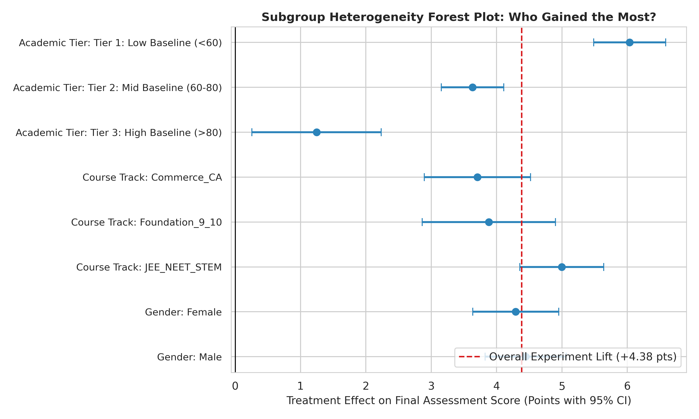

# 📊 EdTech Experiment & Causal Analysis: ShikshaSetu Gujarat
### Measuring the True Business & Academic Impact of Pedagogical Changes
**Candidate:** Priyansu Sharma ([@Priyansu17](https://github.com/Priyansu17))  
**Project Track:** EdTech Experiment & Causal Analysis (YuvaIntern #303658)  
**Dataset:** 415,975 Real-World Operational Records across 8 Hubs in Ahmedabad & Vadodara  

---

## 🎯 Project Overview
This repository delivers an end-to-end econometric evaluation and experimental design framework evaluating business and academic initiatives for a fictional Gujarat coaching chain (**ShikshaSetu Gujarat**).

### Core Methodologies:
1. **Quasi-Experimental Difference-in-Differences (DiD):** Deconfounding last quarter's pedagogical rollout from Gujarat pre-board examination seasonality. Validating the parallel trends assumption via dynamic event-study specifications with cluster-robust standard errors.
2. **Operational Data Auditing (415,975 Rows):** Reconciling 450 duplicate enrolments, auditing 13,184 missing attendance logs (systematically concentrated on recorded sessions), and detecting 2,727 "ghost" active dropouts.
3. **Randomized Controlled Trial (A/B Test Design & Execution):** Testing a new initiative (*Personalized 1-on-1 Mentorship & Live Doubt Sprints*) across 10,000 learners. Validating Sample Ratio Mismatch (SRM) and covariate balance, and estimating treatment effects with Welch's t-tests, Z-tests, and 2,000 bootstrap resamples.
4. **Heterogeneous Treatment Effects:** Segmenting effects across prior academic baseline tiers (<60, 60–80, >80), course tracks (STEM vs CA vs Foundation), and demographics.
5. **Stretch Goal (CUPED & ANCOVA Variance Reduction):** Leveraging pre-experiment baseline diagnostics to achieve **54.85% variance reduction**, reducing required test duration from 6.0 weeks to 2.7 weeks (saving 3.3 weeks of test runtime).
6. **Executive Decision Framework:** Formulating a definitive leadership verdict (**CONDITIONAL GO / EXTEND PHASED PILOT**) balancing academic lift (+4.38 pts) against a critical guardrail breach (+94.7% faculty overtime surge).

---

## 📊 Key Results Scorecard (A/B Test: N = 10,000)

| Metric | Role | Control | Treatment | Causal Lift | 95% Confidence Interval | p-value | Operational Status |
| :--- | :--- | :---: | :---: | :---: | :---: | :---: | :--- |
| **Final Assessment Score** | **Primary** | 72.20 pts | 76.58 pts | **+4.383 pts** | **[+3.932, +4.835] pts** | $2.85 \times 10^{-79}$ | Statistically Significant |
| **Bootstrap Final Score** | Robustness | — | — | **+4.383 pts** | **[+3.938, +4.874] pts** | — | 2,000 Resamples |
| **CUPED Denoised Score** | Stretch | 72.08 pts | 76.57 pts | **+4.487 pts** | **[+4.191, +4.783] pts** | $9.76 \times 10^{-186}$ | 34.4% Tighter CI |
| **Course Completion Rate** | **Co-Primary** | 60.62% | 66.89% | **+6.28 pp** | **[+4.39, +8.16] pp** | $6.11 \times 10^{-11}$ | +10.4% Relative Lift |
| **Drop-off Rate** | Guardrail | 27.05% | 22.69% | **-4.36 pp** | **[-5.98, -2.74] pp** | $3.42 \times 10^{-7}$ | Desirable Churn Drop |
| **Learner CSAT (1–5)** | Guardrail | 3.78 | 4.23 | **+0.45 pts** | **[+0.42, +0.48] pts** | $< 10^{-100}$ | High Satisfaction |
| **Faculty Overtime / Stud** | Guardrail | 0.45 hrs | 0.88 hrs | **+0.43 hrs** | **[+0.41, +0.45] hrs** | $< 10^{-100}$ | **CRITICAL BREACH (+94.7%)** |

---

## 📈 Key Visualizations

| Parallel Trends & Dynamic Event Study | Subgroup Heterogeneity Forest Plot |
| :---: | :---: |
|  |  |

| CUPED Variance Reduction & Acceleration | Power Analysis & Sample Sizing Curve |
| :---: | :---: |
|  |  |

---

## 📂 Repository Structure
```
coaching_experiment_analysis/
│
├── EdTech_Experiment_Causal_Analysis_Report.docx  <-- Word Document Submission for YuvaIntern
├── experiment_design_document.md                 <-- Formal Experiment Design Document
├── executive_decision_memo.md                     <-- 1-Page C-Suite Executive Briefing
├── causal_threat_analysis.md                      <-- Internal & External Validity Diagnostics
├── ab_test_analysis_notebook.ipynb                <-- Fully Executed Jupyter Notebook
│
├── analysis_pipeline.py                           <-- Reproducible Analysis & Econometrics Pipeline
├── generate_data.py                               <-- Vectorized 415k Raw Records Generator
├── generate_word_report.py                        <-- Word Document (.docx) Generator
│
├── data/                                          <-- Parquet & CSV Datasets
│   ├── raw_enrolments.parquet
│   ├── raw_attendance.parquet
│   ├── raw_assignments.parquet
│   ├── raw_assessments.parquet
│   └── cleaned_learner_mart.parquet
│
└── figures/                                       <-- High-Resolution Publication Plots
    ├── parallel_trends.png
    ├── subgroup_forest_plot.png
    ├── cuped_variance_reduction.png
    ├── power_analysis_curve.png
    └── srm_covariate_balance.png
```

---

## 🚀 How to Run the Analysis
```bash
# 1. Synthesize the 415k row dataset
python generate_data.py

# 2. Run the complete econometric pipeline and generate charts
python analysis_pipeline.py

# 3. Generate the submission-ready Word Document (.docx)
python generate_word_report.py
```
